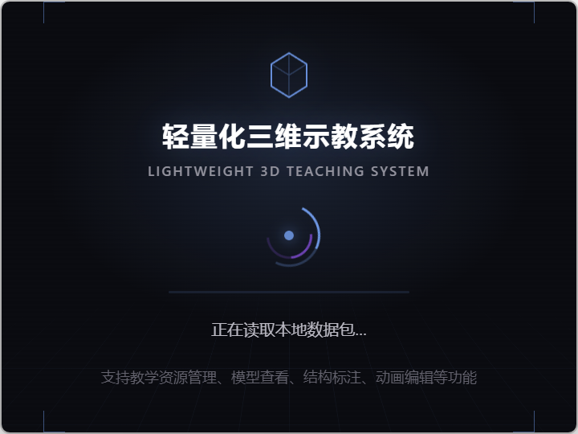
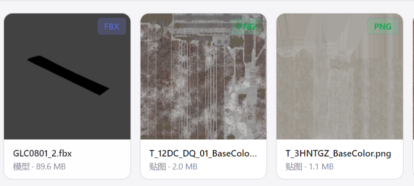
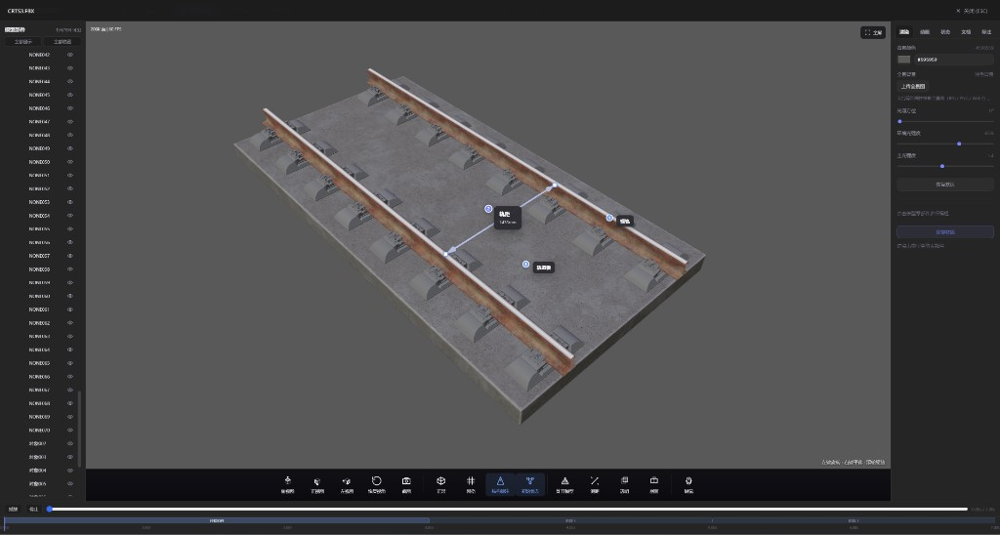
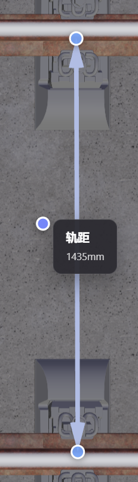
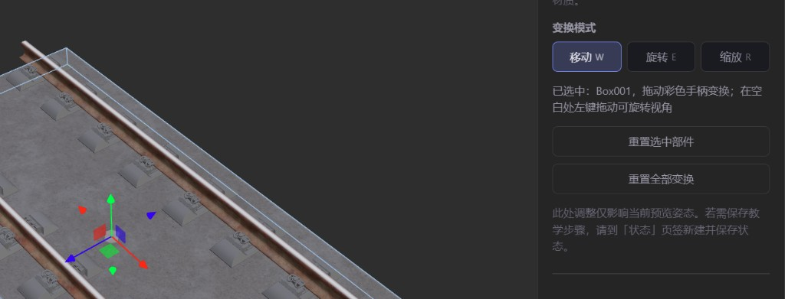
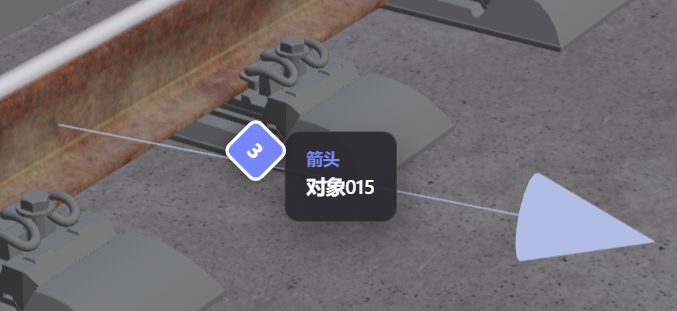
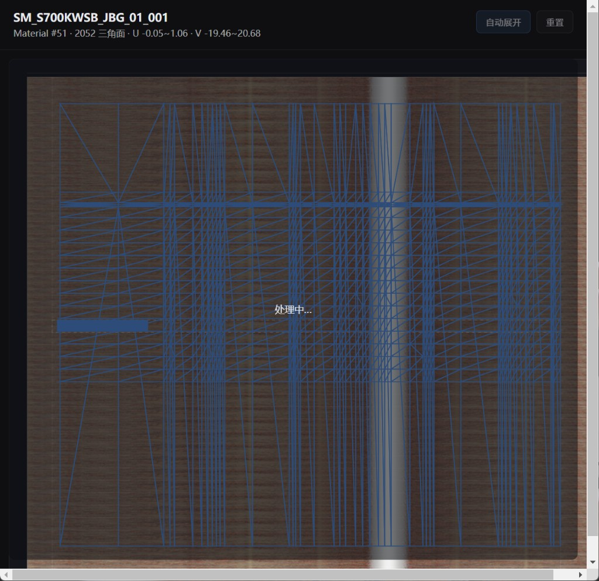

# 轻量化三维示教系统  
使用说明书（用户版）

面向终端用户 · 功能与操作说明

---

## 1. 软件简介

**轻量化三维示教系统**是一款 Windows 桌面应用，用于课堂教学与三维资源查看、标注与示教演示。

软件需**激活后使用**。首次安装可开启 **7 天全功能试用**（每台电脑一次），或输入正式激活码。无需账号登录。

> **说明**：软件激活码与数据包激活码相互独立，使用同一机器码，但激活码不同，请勿混用。

支持两种浏览模式：

| 模式 | 说明 |
| --- | --- |
| **本地** | 浏览电脑上的任意文件夹 |
| **数据包** | 安装并激活 `.3dam-pack` 离线数据包，浏览其中的模型与媒体 |

### 主要功能一览

- 本地文件夹与数据包浏览、搜索与排序
- 多格式 3D 模型预览（视角、截图、炸开、测距、透明、剖面等）
- 部件移动 / 旋转 / 缩放与材质编辑
- 结构标注、部件动画、教学状态切换
- 关联 PDF 文档、贴图 / 音视频预览
- 自定义缩略图、资产重命名、界面外观设置

*图 1　软件启动加载界面*

---

## 2. 安装与启动

1. 双击便携版程序（如 `轻量化三维示教系统-1.0.0-Portable.exe`）启动
2. 首次启动进入激活界面：可点 **「开始 7 天试用」**，或粘贴正式激活码
3. 激活成功后默认进入「数据包」模式；可切换到「本地」浏览自己的文件夹
4. 若已购买数据包，点击 **「安装数据包」** 导入 `.3dam-pack` 文件

### 激活软件

1. 激活界面显示本机 **机器码**，请提供给销售方以获取正式激活码
2. 试用或正式授权到期后，需输入新的正式激活码才能继续使用
3. 工具栏版本号旁会显示试用 / 授权剩余天数（永久授权显示「已授权」）

> 最终用户只需：程序文件、软件激活码，以及内容方提供的数据包与数据包激活码。

---

## 3. 浏览与管理

工具栏可在 **本地** / **数据包** 之间切换。

*图 2　资源库中的模型与贴图卡片（含缩略图、类型与大小）*

### 3.1 本地模式

1. 点击 **「选择文件夹」** 选择项目根目录
2. 用左侧子目录、面包屑切换目录
3. 单击选中资产，双击或点「预览」全屏查看
4. 可 **「在资源管理器中打开」** 定位原文件

在根目录搜索时，会在整个目录树中按文件名查找。

### 3.2 数据包模式

1. 根目录显示各数据包文件夹（名称与数据包一致）
2. **双击**文件夹进入，查看其中的模型与贴图等
3. 顶部面包屑或 **「上级」** 返回数据包列表
4. 在根目录搜索时，会在**全部已激活数据包**中跨包查找

#### 安装与激活数据包

1. 点击 **「安装数据包」**，选择 `.3dam-pack` 文件
2. 若需激活，安装后会弹出激活窗口；也可在工具栏 **「管理」** 中对未激活的包点 **「激活」**
3. 将界面显示的机器码提供给内容方，获取**数据包激活码**后输入

#### 删除数据包

- 根目录选中数据包文件夹 → 右侧面板 **「删除数据包」**
- 或工具栏 **「管理」** → 对应包 **「卸载」**
- 进入包内后，也可删除单个模型

#### 重命名资产

进入数据包后：

- **双击**卡片或列表中的文件名编辑，回车确认，Esc 取消
- 或在右侧信息面板点 **「重命名」**
- 扩展名会自动保留；同文件夹下不能重名

#### 自定义模型缩略图

选中数据包中的模型后，在右侧信息面板：

- **「设置缩略图」**：选择本机图片作为卡片缩略图
- **「恢复默认缩略图」**：恢复自动生成的预览图

### 3.3 视图与外观

- **网格 / 列表**：工具栏切换卡片或列表展示
- **缩略图大小**：滑块调节 50%～200%
- **外观**：可自定义强调色与背景色，自动保存

---

## 4. 3D 模型预览

双击支持的模型文件，进入全屏 3D 预览。按 `Esc` 或点右上角关闭。

*图 3　3D 预览主界面：左侧结构树、中间视口、右侧功能页签、底部工具栏*

### 4.1 界面布局

- **左侧**：部件结构树
- **中间**：3D 视口；选中部件名称显示在视口顶部
- **右侧**：编辑 / 动画 / 状态 / 文档 / 标注等标签页
- **底部**：视角、截图、标注、教学状态、炸开、测距、渲染等工具

### 4.2 视口操作

| 操作 | 鼠标 | 触摸 |
| --- | --- | --- |
| 旋转 | 左键拖动 | 单指滑动 |
| 缩放 | 滚轮 | 双指捏合 |
| 平移 | 右键拖动（或中键） | 双指并排滑动 |

底部工具栏可切换 **鼠标 / 触摸** 输入模式。

### 4.3 左侧部件结构树

- 点击选中零部件
- 点击眼睛图标显示 / 隐藏
- **双击**名称可重命名（仅影响界面显示名）
- 再次点击已选中部件可取消选中

### 4.4 底部工具栏

| 工具 | 说明 |
| --- | --- |
| 俯视图 / 正视图 / 左视图 | 切换标准视角 |
| 恢复视角 | 回到打开模型时的初始视角 |
| 截图 | 截取视口并保存到桌面 |
| 正常 / 面框 | 切换实体与面框显示 |
| 网格 | 显示 / 隐藏底部参考网格 |
| 标注 | 选择要显示的标注集合（数据包模型） |
| 教学状态 | 快速切换已保存的教学状态（数据包模型） |
| 炸开模型 | 将零部件沿法线散开 |
| 测距 | 在模型表面测量两点距离 |
| 透明 | 点击部件使其半透明 |
| 剖面 | 沿 X / Y / Z 轴剖切 |
| 鼠标 / 触摸 | 切换输入模式 |
| 渲染 | 弹出窗口调节光照、背景等 |

*图 4　在模型上使用测距工具（示意：轨距测量标注）*

### 4.5 右侧标签页

| 标签 | 功能 | 适用范围 |
| --- | --- | --- |
| **编辑** | 部件变换 + 材质编辑 | 所有模型 |
| **动画** | FBX 动画 + 部件关键帧动画 | 所有模型 |
| **状态** | 教学状态编辑与切换 | 数据包模型 |
| **文档** | 上传与切换关联 PDF | 数据包模型 |
| **标注** | 结构标注集合与标记 | 数据包模型 |

---

## 5. 编辑与材质

### 5.1 渲染设置

点击底部工具栏 **「渲染」**，可调节：

- 背景颜色
- 光照方位
- 环境光强度、主光强度
- STL 模型的朝上轴向（仅 STL）

设置会自动保存，并影响后续缩略图效果。

### 5.2 部件变换

在 **「编辑」** 标签中：

1. 在结构树或模型上点击选中部件
2. 选择 **移动 / 旋转 / 缩放**，拖动彩色变换轴进行调整
3. **再次点击**当前模式（或再按对应快捷键）可取消并**隐藏变换轴**
4. 可用 **重置选中部件** 或 **重置全部变换** 恢复打开时的姿态

空白处左键仍可旋转视角。

*图 5　编辑页：选中部件后显示移动坐标轴；右侧可切换移动 / 旋转 / 缩放*

| 键 | 功能 |
| --- | --- |
| `W` | 切换移动（再按取消） |
| `E` | 切换旋转（再按取消） |
| `R` | 切换缩放（再按取消） |

> 此处调整仅影响当前预览姿态。若要保存为可切换步骤，请到 **「状态」** 标签保存。

### 5.3 材质编辑

在 **「编辑」** 标签下方：

1. 选中零部件（可与变换共用选中）
2. 多材质时切换材质槽位，或直接点击模型上对应面
3. 调节基础色、透明度、基础色贴图、法线贴图等
4. 数据包模型的材质修改会自动保存

> 本地模型可预览编辑；**持久保存**一般仅对数据包中的模型生效。

---

## 6. 动画与教学状态

### 6.1 FBX 动画

若 FBX 含动画片段，预览底部会出现动画控制条：选择片段、播放 / 暂停。  
数据包模型会记住默认片段与是否自动播放。

### 6.2 部件动画

在 **「动画」** 标签可为零部件录制位移 / 旋转关键帧，动画由多个**阶段**组成。

**阶段：**

- **新建阶段**、双击重命名
- **播放**当前阶段，或 **播放全部**
- 可调整阶段时长；时间轴上可切换阶段

**录制：**

1. 选中零部件
2. 拖动手柄或输入位移 / 旋转数值
3. 移到目标时刻，点 **「在当前时间添加关键帧」**（会自动保存）

动画编辑时：`W` 位移、`E` 旋转、`空格` 播放 / 暂停。

### 6.3 教学状态

在 **「状态」** 标签可将当前场景存为命名快照，适合拆装步骤、构型对比等一键切换。

每个状态可包含：部件位置 / 旋转 / 缩放 / 可见性，以及材质与贴图方案。

**与部件动画的区别：**

| | 部件动画 | 教学状态 |
| --- | --- | --- |
| 形式 | 时间轴、关键帧 | 「第几步 / 叫什么名字」 |
| 切换 | 播放、拖时间 | 点状态名或底栏切换 |
| 材质 | 不纳入轨道 | 每状态可含材质快照 |
| 适用 | 连续运动 | 步骤切换、静态对比 |

**操作：**

1. 输入名称 → **新建状态**
2. 调整部件与材质后点 **保存**
3. 课堂演示时用底栏 **教学状态** 或侧栏 **预览** 切换
4. 可将某一状态 **设为默认**，下次打开自动应用

---

## 7. 结构标注与关联文档

### 7.1 结构标注（数据包模型）

支持多个标注集合，同时只显示一个集合。

| 类型 | 说明 |
| --- | --- |
| 标记点 | 圆点标记，可附名称与说明 |
| 箭头 | 两点之间的箭头 |
| 图文 | 带图片的说明标注 |

**步骤：**

1. 打开模型 → **「标注」** 标签
2. **新建集合** → **添加标记**，在模型表面点击放置
3. 选择类型、填写说明并保存；之后可拖动调整位置
4. 底栏 **「标注」** 可快速切换显示的集合

*图 6　在模型上放置结构标注（如箭头标记）*

### 7.2 关联文档

在 **「文档」** 标签：

1. **上传 PDF**
2. 点击文档名称后，预览区分屏：左侧三维、右侧 PDF
3. 可删除不需要的文档

### 7.3 UV 查看器

选中带 UV 的部件后按 **`V`**：独立窗口查看 UV 与贴图；滚轮缩放、拖拽平移。

*图 7　UV 查看器：查看选中部件的 UV 布局与贴图*

---

## 8. 其他资产预览

| 类型 | 操作 |
| --- | --- |
| 贴图 | 滚轮缩放、拖动平移 |
| 音频 / 视频 | 全屏播放器控制 |
| PDF | 全屏阅读 |

选中后，右侧信息面板会显示分辨率、时长、大小等信息。

---

## 9. 支持的文件格式

### 三维模型

`.gltf` / `.glb` / `.obj` / `.fbx` / `.3ds` / `.stl`

> 不支持直接打开 `.max`。请先在 3ds Max 中导出为 FBX、GLB 或 OBJ。

### 图片

`.jpg` `.png` `.webp` `.gif` `.bmp` `.tiff` `.tga` `.ico` `.svg` `.exr` `.hdr` 等

### 音视频与文档

- 音频：`.mp3` `.wav` `.ogg` `.flac` `.m4a` 等  
- 视频：`.mp4` `.webm` `.mov` `.mkv` 等  
- 文档：`.pdf`

### 关于大型模型

- 超大 FBX 首次加载可能较慢，请耐心等待
- STL 仅含几何体，无贴图与动画；默认按文件 +X 轴朝上显示
- 超过约 100 万面时，可能提示是否减面以提升流畅度

---

## 10. 常见问题

### 软件激活失败

- 确认使用的是**软件激活码**，不是数据包激活码
- 确认激活码与当前机器码匹配
- 若已用过试用，需购买正式授权

### 数据包安装 / 激活失败

- 确认扩展名为 `.3dam-pack`
- 同一数据包可重新安装覆盖旧版
- 激活码须与机器码、当前数据包对应
- 未激活的包不会出现在根目录列表，请到 **「管理」** 查看

### 找不到模型

- 先双击进入对应数据包文件夹（根目录只显示文件夹）
- 用搜索框按文件名跨包查找

### 缩略图异常或预览黑屏

- 缩略图失败时常显示占位图，可重启后再试，或使用「设置缩略图」
- 预览黑屏：确认文件完整；OBJ / FBX 请检查贴图是否在模型同目录（或 `模型名.fbm`）
- 可贴图闪烁：多为共面薄板深度冲突，可换角度观察；严重时请内容方优化模型后重导

### FBX 打不开或缩略图失败

可请内容方重新导出为 **FBX 7.4+ 二进制** 或 **GLB**，并保证外置贴图与模型在一起。

### 清理本机数据

删除文件夹 `%APPDATA%\3d-asset-manager\` 可清除激活、已装数据包与编辑数据。删除后需重新激活并安装数据包。

---

## 11. 快捷键一览

以下快捷键在 3D 预览中生效（输入框聚焦时不触发）：

| 按键 | 功能 |
| --- | --- |
| `Esc` | 关闭预览 |
| `V` | 打开选中部件的 UV 查看器 |
| `W` | 编辑：切换移动轴（再按取消）；动画 / 状态：位移 |
| `E` | 编辑：切换旋转轴（再按取消）；动画 / 状态：旋转 |
| `R` | 编辑：切换缩放轴（再按取消）；教学状态：缩放 |
| `空格` | 动画编辑：播放 / 暂停部件动画 |

UV 查看器内：滚轮缩放，左键拖拽平移。

---

*轻量化三维示教系统 · 用户使用说明书*
